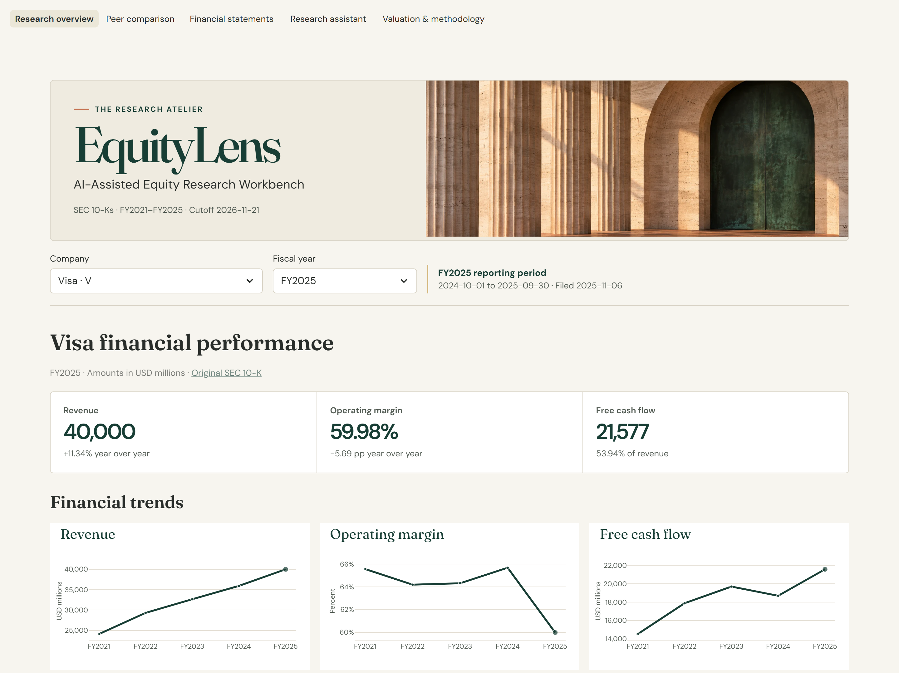
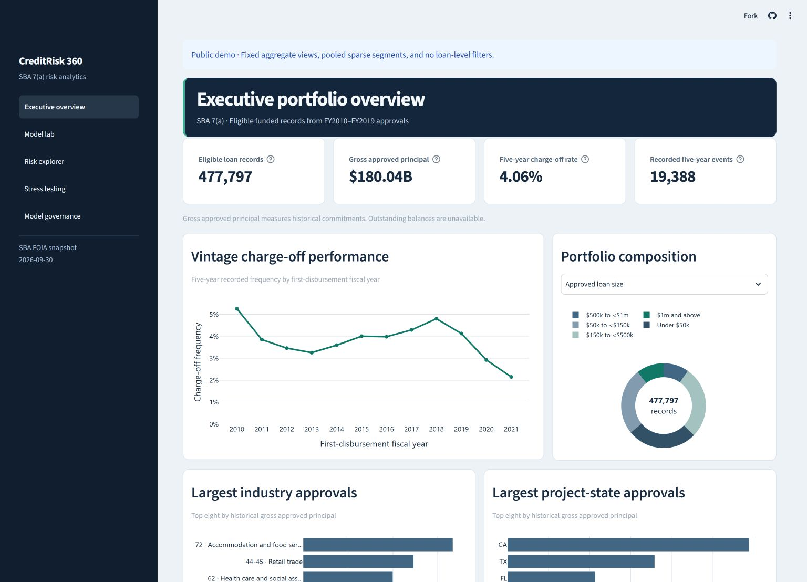
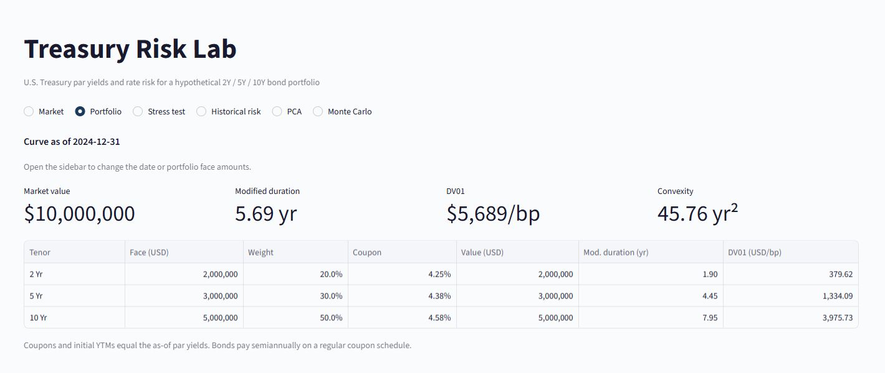
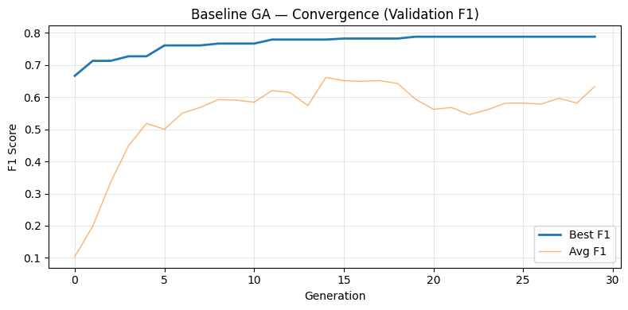

# Financial Analytics & Quantitative Research Portfolio

**Anand Mathur** 
MS Business Analytics | University of Illinois Chicago

I’m interested in how financial institutions use data to make decisions when the evidence is incomplete and the trade-offs matter. My projects connect financial statement analysis, quantitative risk management, and machine learning to questions about company performance, lending, market risk, and fraud. I use data engineering to automate repeatable analyses and statistical modeling to test what the data supports. I’m especially interested in interpretable AI and optimization, where analysts need to understand why a model flags a case or how a decision affects review capacity. I build interactive tools so people can explore those decisions and inspect the evidence behind them.

[Featured Projects](#featured-projects) · [Technical Skills & Tools](#technical-skills--tools) · [About Me](#about-me)

## Featured Projects

### 01. EquityLens — Financial Intelligence & Interactive Research Assistant

**Which payment companies turn revenue growth into profitability and cash generation, and how reliably can their disclosures be compared?**

EquityLens benchmarks Visa, Mastercard, and PayPal across five years of SEC disclosures (FY2021–FY2025). It brings peer comparisons, financial statements, cash flows, and illustrative valuation sensitivities into one Streamlit workbench. In the chat-style research assistant, analysts can ask questions about changes in performance and verify answers through deterministic SQL calculations and cited 10-K excerpts.

**[Launch Live Dashboard](https://equitylens-ywwjzfgfgt8uubb88mgtbk.streamlit.app/)** · [View GitHub Repository](https://github.com/Am2210/Equity-Lens)

**Key skills** · `Python` `SQL` `DuckDB` `Streamlit` · SEC EDGAR ingestion, financial statement standardization, ratio analysis, peer benchmarking, cited filing retrieval, and valuation sensitivity.

---

### 02. CreditRisk 360 — Machine Learning & Credit Risk Analytics

**Which small-business lending characteristics are associated with higher recorded charge-off risk, and how can models help prioritize portfolio review?**

CreditRisk 360 uses historical SBA 7(a) records to study five-year recorded charge-offs. It compares logistic regression, random forest, and XGBoost, then examines calibration and portfolio stress scenarios. XGBoost reached **0.7165 ROC-AUC** on the retrospective holdout, and the highest validation-defined risk group captured **30.8% of holdout charge-offs**. For a team with limited review capacity, ranking helps prioritize cases, while calibration checks whether estimated rates match observed outcomes.

**[Launch Live Dashboard](https://creditrisk360-eveittxvutuwaig2upqksd.streamlit.app/)** · [View GitHub Repository](https://github.com/Am2210/CreditRisk360)

*The public demo uses aggregate data and offers a narrower set of interactions than the full local application.*

**Key skills** · `Python` `SQL` `DuckDB` `Streamlit` · Feature engineering, holdout validation, probability calibration, SHAP, and credit portfolio monitoring.

---

### 03. Treasury Risk Lab — Quantitative Finance & Market Risk

**How much could a fixed-income portfolio lose when interest rates change, and which exposures contribute most to that risk?**

Treasury Risk Lab uses historical U.S. Treasury yield curves to reprice a hypothetical **$10 million** bond portfolio. The December 31, 2024 reference portfolio had a **DV01 of about $5,689 per basis point** and a **95% historical Expected Shortfall of about $71,697**, the average modeled loss in the worst 5% of scenarios. Traders and risk analysts can compare custom curve shocks and see which maturities contribute to historical downside.

**[Launch Live Dashboard](https://treasury-risk-lab-cz4gdchv4lvhxfa3j8upgr.streamlit.app/)** · [View GitHub Repository](https://github.com/Am2210/treasury-risk-lab)

**Key skills** · `Python` `Streamlit` · Bond pricing, duration and convexity, VaR and Expected Shortfall, stress testing, PCA, and Monte Carlo simulation.

---

### 04. TransUnion Capstone — Fraud Optimization & Evolutionary Algorithms

**Can evolutionary algorithms find readable fraud rules that balance fraud capture with the workload of investigating alerts?**

In this TransUnion-sponsored UIC MSBA capstone, our team compared genetic algorithms, cooperative coevolution, and NSGA-II to discover human-readable IF–THEN rules. Investigators can inspect the conditions behind an alert, while precision, recall, and alert rate let teams compare how much fraud a rule catches against the review workload it creates.

**[View My Development Repository](https://github.com/Am2210/TransUnion_-EA-for-business-rules-)** · [View Final Team Project](https://github.com/dsany94/transunion-fraud-rule-optimization)

*Baseline genetic algorithm validation F1 by generation from the earlier Kaggle development experiment. The final integrated team study used synthetic transactions.*

**Team** · Debangana Sanyal, Adrian Garces, Sam Chyu, Anand Mathur, and Siddhi Jain.

**Key skills** · `Python` `DEAP` · Evolutionary search, multi-objective optimization, interpretable rule design, and precision, recall, and alert-rate evaluation.

## Technical Skills & Tools

- **Programming & Data Engineering** · Python, SQL, pandas, DuckDB, APIs, and reproducible data pipelines.
- **Machine Learning & Statistics** · Logistic regression, random forest, XGBoost, PCA, model validation, probability calibration, and SHAP explainability.
- **Financial & Quantitative Analytics** · Financial statement analysis, credit and portfolio risk, bond pricing, VaR, Expected Shortfall, Monte Carlo, and fraud optimization.
- **Applications & Decision Support** · Streamlit, interactive dashboards, evidence-backed research interfaces, and financial visualization.

## About Me

My MS in Business Analytics at the University of Illinois Chicago gave me practice translating business questions into statistical models and interactive tools. Working with teammates on the TransUnion capstone sharpened my interest in how teams evaluate analytical results against operational constraints. That experience continues to shape my interests in quantitative finance, financial services, and applied data science.
